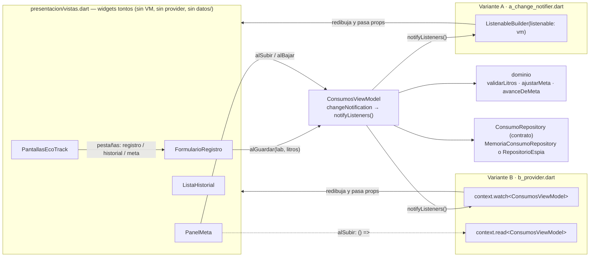

# PLAN.md — EcoTrack «Meta semanal» (`ecotrack_meta`)

> **Única fuente de verdad** para la implementación (etapas 0–6).
> Generado por el prompt de planeación a partir de la lectura de `kit_alumno/test/` (5 archivos + `soporte/`)
> y `kit_alumno/verificar_estado.sh`. **No contiene código de producción**: solo contratos (firmas), decisiones,
> pasos y criterios. Los cuerpos de los métodos se escriben en la etapa que corresponda.
> Regla rectora ante cualquier duda: **las pruebas y el script ganan sobre el enunciado.**

---

## 1. Resumen y reglas

**Misión.** Pantalla **Meta semanal** con tres pestañas que comparten un mismo dato:

| Pestaña | Qué hace |
|---|---|
| Registro | guarda un consumo (laboratorio + litros) |
| Historial | lista los consumos y muestra su total |
| Meta | compara el total con una meta ajustable (± botones) y avisa si se rebasó |

Se construye **desde un proyecto vacío, en capas y con MVVM**, cableando **el mismo `ConsumosViewModel` dos veces**:

- **A — ChangeNotifier puro:** `ChangeNotifier` + ViewModel pasado por constructor (`variantes/a_change_notifier.dart`).
- **B — provider:** el mismo ViewModel colgado del árbol con `ChangeNotifierProvider` (`variantes/b_provider.dart`).

Al final, `docs/estado.md` documenta la evidencia con **fragmentos de mi propio código** (archivo + líneas).

**Reglas duras:**

1. **NO** editar `kit_alumno/test/` ni `kit_alumno/verificar_estado.sh` (solo copiar, byte a byte).
2. Respetar los contratos al pie de la letra: archivos, clases, métodos, parámetros, textos, llaves.
3. Etapas en orden 0→6; **no avanzar con pruebas en rojo** (cada etapa deja verdes sus pruebas + las anteriores).
4. **Un commit por etapa**, con el mensaje exacto de cada sección (Conventional Commits).
5. **No** copiar archivos de `ecotrack_estado/` (no existe en este repo; no buscarlo).
6. Proyecto llamado **`ecotrack_meta`** → `pubspec.yaml` con `name: ecotrack_meta` (las pruebas importan `package:ecotrack_meta/...`).

**Ubicación asumida** (ver pregunta abierta #1): el proyecto vive en `meta-ecotrack/ecotrack_meta/`
(subcarpeta del repo que contiene `kit_alumno/`), y este `PLAN.md` está en su raíz:

```
meta-ecotrack/                    ← raíz del repo (donde vive kit_alumno/)
├── kit_alumno/                   ← INTOCABLE (test/ + verificar_estado.sh)
└── ecotrack_meta/                ← proyecto Flutter (raíz de trabajo)
    ├── PLAN.md                   ← este archivo (Etapa 0, commiteado)
    ├── pubspec.yaml              name: ecotrack_meta + provider
    ├── verificar_estado.sh       copia byte a byte del kit
    ├── test/                     copia byte a byte de kit_alumno/test/
    ├── lib/ …
    └── docs/estado.md            (Etapa 6)
```

**Entorno verificado:** Flutter 3.47.4 stable · Dart 3.13.3 · Windows (win32) · repo git con 2 commits previos.

**Inventario del kit leído (solo lectura):**

| Archivo del kit | Qué aporta |
|---|---|
| `test/etapa1_dominio_test.dart` | 10 pruebas — dominio puro |
| `test/etapa2_datos_test.dart` | 4 pruebas — contrato + memoria |
| `test/etapa3_viewmodel_test.dart` | 11 pruebas — ViewModel sin pantallas |
| `test/etapa4_change_notifier_test.dart` | 5 pruebas — vistas tontas + cableado A |
| `test/etapa5_provider_test.dart` | 5 pruebas — cableado B |
| `test/soporte/flujos.dart` | `guardarLitros()` (Key `litros` + tap `Guardar`) e `irA()` (tap de pestaña) |
| `test/soporte/repositorio_espia.dart` | `RepositorioEspia implements ConsumoRepository` → criterio «Sustitución» |
| `verificar_estado.sh` | 8 secciones que revisan capas y cableado (no la funcionalidad) |

**Total: 35 pruebas.** El script **no** las sustituye: `flutter test` revisa que la app funcione;
`verificar_estado.sh` revisa arquitectura. Ambos deben quedar en verde al final.

---

## 2. Hallazgos del kit

### 2.1 Tabla `Prueba → qué exige → etapa`

#### `etapa1_dominio_test.dart` (10 pruebas)

| Prueba | Qué exige (lo que el enunciado NO dice o no aclara) | Etapa |
|---|---|---|
| `Consumo/laboratoriosUtez tiene los tres laboratorios` | `const laboratoriosUtez` **exactamente** `['Lab Química', 'Lab Redes', 'Lab Física']`, en ese orden | 1 |
| `Consumo guarda laboratorio y litros` | `const Consumo({required this.laboratorio, required this.litros})` con campos `final` | 1 |
| `validarLitros/null pide número` | `validarLitros(null) == 'Escribe los litros con número'` (**null checa primero**) | 1 |
| `cero o negativo se rechaza` | `0` y `-3` → `'Los litros deben ser mayores que cero'` | 1 |
| `más del tope se rechaza` | `10001` → `'Los litros superan el tope de 10000'` | 1 |
| `un valor válido devuelve null` | `12.5` y **`10000` exacto** → `null` ⇒ el tope es **estrictamente mayor** (`> 10000`) | 1 |
| `constantes de la meta` | `metaInicial = 100.0`, `pasoMeta = 10.0`, `metaMinima = 10.0` | 1 |
| `ajustarMeta suma el cambio` | `ajustarMeta(100, 10) == 110`, `ajustarMeta(100, -10) == 90` (aritmética exacta) | 1 |
| `ajustarMeta no baja de metaMinima` | piso en `10.0`: `15-10 → 10`, `10-10 → 10`. **No hay techo** (no se prueba ni se pide) | 1 |
| `avanceDeMeta va de 0 a 1` | `total:0→0`, `50/100→0.5`, **`150/100→1`** ⇒ **clamp** al rango [0,1] | 1 |

#### `etapa2_datos_test.dart` (4 pruebas)

| Prueba | Qué exige | Etapa |
|---|---|---|
| `cumple el contrato ConsumoRepository` | `MemoriaConsumoRepository()` **sin argumentos** y `isA<ConsumoRepository>()` | 2 |
| `empieza vacío` | `todos()` inicial `isEmpty` | 2 |
| `guarda y devuelve en orden` | **orden de inserción preservado** (`[5, 7]`, `first.laboratorio == 'Lab Redes'`) | 2 |
| `todos() no deja modificar la lista interna` | `lista.add(...)` lanza **`UnsupportedError`** ⇒ devolver `List.unmodifiable(...)`, **nunca** `List.of` ni la lista cruda | 2 |

#### `etapa3_viewmodel_test.dart` (11 pruebas)

| Prueba | Qué exige | Etapa |
|---|---|---|
| `es un ChangeNotifier` | `class ConsumosViewModel extends ChangeNotifier` (y el script exige **`foundation.dart`**, no `material.dart`) | 3 |
| `empieza vacío, sin error y con la meta inicial` | `consumos=[]`, `error=null`, `guardando=false`, `meta=metaInicial`, `total=0`, `avance=0`, `metaSuperada=false` | 3 |
| `cargar() trae lo que ya tenía y avisa` | `cargar()` reemplaza `consumos` con `todos()` **y llama `notifyListeners()`** (`avisos > 0`) | 3 |
| `guardar válido llega al repositorio y actualiza consumos` | devuelve `true`; `Consumo(laboratorio, litros)` correcto en el repo; `consumos` actualizado; `error=null`; `guardando=false` al final | 3 |
| `guardar acepta coma decimal` | **`'12,5'` → `12.5`** ⇒ parse con `replaceAll(',', '.')` antes de `double.tryParse` (**no mencionado en el enunciado**) | 3 ⚠ |
| `guardar avisa "guardando" y luego "listo"` | **el PRIMER `notifyListeners()` de `guardar()` tiene `guardando == true`** y el **ÚLTIMO `guardando == false`** ⇒ avisar **antes** de parsear/await y **al final** del camino feliz | 3 ⚠ |
| `guardar inválido pone el error y no guarda` | devuelve `false`; `error` = mensaje **del dominio**; `espia.recibidos` **vacío**; **`avisos > 0`** (el camino inválido también notifica) | 3 |
| `un guardado correcto limpia el error anterior` | `error` vuelve a `null` en un guardar bueno (limpiar al inicio de cada intento) | 3 |
| `total, avance y metaSuperada se derivan` | 30+20 → `total 50`, `avance 0.5`, `metaSuperada false`; +60 → `total 110`, **`avance 1`** (clamp), `metaSuperada true` | 3 |
| `subirMeta y bajarMeta cambian la meta y avisan` | **exactamente 1 `notifyListeners()` por acción** (`avisos == 3` tras 1 subida + 2 bajadas) ⇒ **nada de doble aviso** | 3 ⚠ |
| `bajarMeta nunca deja la meta por debajo de metaMinima` | 30 bajadas seguidas → `metaMinima` (el piso vive en el dominio, no en el VM) | 3 |

#### `etapa4_change_notifier_test.dart` (5 pruebas)

| Prueba | Qué exige | Etapa |
|---|---|---|
| `Dato compartido: Registro guarda, Historial y Meta lo ven` | `tester.pumpWidget(AppChangeNotifier(repositorio: …))` **sin `MaterialApp` externo** ⇒ el widget raíz **arma su propio `MaterialApp`**; pestaña inicial = **Registro** (Key `litros` + botón `Guardar` visibles); `find.text('Consumo guardado')` **findsOneWidget**; `Total: 12.5 L`; `Usado: 12.5 de 100.0 L`; `Dentro de la meta` | 4 |
| `Sustitución: con otra fuente de datos las pantallas no cambian` | `RepositorioEspia` con **40 L iniciales visibles tras arrancar** ⇒ **`cargar()` es obligatorio al iniciar** (initState); luego guardar 12.5 → `Total: 52.5 L` y `espia.recibidos.single.litros == 12.5` | 4 |
| `Capas: el error del dominio aparece y no se guarda nada` | tras `'0'`, `find.text('Los litros deben ser mayores que cero')` **findsOneWidget** (un solo lugar de visualización) y repo intacto | 4 |
| `Meta: los botones cambian la meta y el aviso de rebase` | Keys `subirMeta`/`bajarMeta` accionables; `120 vs 100` → `Te pasaste de la meta`; **`120 vs 120` → `Dentro de la meta`** ⇒ `metaSuperada` es **`total > meta` estricto**; todo con **1 decimal** | 4 ⚠ |
| `HistorialCN recibe vm por constructor y se redibuja` | `HistorialCN({super.key, required this.vm})` funciona **suelto** dentro de un `MaterialApp/Scaffold` de prueba; `Sin consumos` → `Total: 5.0 L` tras `vm.guardar`; el test hace **`vm.dispose()` él mismo** ⇒ **el adaptador NO debe disposear un vm que no creó** | 4 ⚠ |

#### `etapa5_provider_test.dart` (5 pruebas)

| Prueba | Qué exige | Etapa |
|---|---|---|
| `Dato compartido…` / `Sustitución…` / `Capas…` / `Meta…` | idénticas a la etapa 4 pero bombeando `AppProvider(repositorio: …)` **sin `MaterialApp` externo** ⇒ `AppProvider` también arma su `MaterialApp` | 5 |
| `Los adaptadores piden el ViewModel al árbol, no al constructor` | `HistorialProvider()` y `MetaProvider()` aparecen **dentro de un `const MaterialApp(...)`** ⇒ constructores **`const` sin parámetros requeridos**; con `context.watch` pintan y con `context.read` accionan (`subirMeta` → `Usado: 8.0 de 110.0 L`) | 5 ⚠ |

### 2.2 Discrepancias enunciado ↔ pruebas (**ganan las pruebas**)

1. **Coma decimal:** el enunciado no lo menciona; el test exige `'12,5' → 12.5`.
2. **Orden/contador de `notifyListeners()`:** el test exige que el **primer** aviso de `guardar()` tenga
   `guardando == true` (incluso si aún no sabemos si es válido) y que las acciones de meta generen
   **exactamente un** aviso (`avisos == 3`).
3. **`avance` acotado:** el enunciado no dice clamp; el test exige `110/100 → 1` (no `1.1`).
4. **`metaSuperada` estricta:** `total == meta` (120 vs 120) ⇒ **`Dentro de la meta`**, o sea `>` y no `>=`.
5. **`todos()` inmutable:** el contrato solo dice `Future<List<Consumo>> todos()`; el test exige que
   `add` lance `UnsupportedError`.
6. **`cargar()` al arrancar:** no está en el cronograma, pero ambas variantes **deben** llamarlo
   (si no, el test «Sustitución» no ve los 40 L iniciales).
7. **Los widgets raíz incluyen `MaterialApp`:** los tests bombean `AppChangeNotifier`/`AppProvider`
   directamente; sin `MaterialApp` no hay `Directionality`/`Material` y `TextField`/`BottomNavigationBar` revientan.
8. **Adaptadores provider `const` sin args:** obligado por el `const MaterialApp(...)` del test final.
9. **`findsOneWidget`:** el aviso `Consumo guardado` y el error del dominio deben mostrarse en
   **un solo lugar** (mostrarlos en dos sitios = falla).
10. **El enunciado no describe la UI del laboratorio:** decisión de diseño → `DropdownButtonFormField`
    con `laboratoriosUtez`, valor por defecto `Lab Química` (los tests no lo verifican).
11. **El enunciado no describe el aviso de guardado:** decisión de diseño → `Text` **inline** en
    `FormularioRegistro` vía `setState` (estado efímero), no `SnackBar` (ver riesgo #11).

### 2.3 Lo que exige `verificar_estado.sh` y NO dicen las pruebas

| # | Chequeo del script | Consecuencia en el código |
|---|---|---|
| 1 | existen los 11 archivos del contrato (`lib/…` + `docs/estado.md`) | `docs/estado.md` recién en Etapa 6 |
| 2 | `lib/dominio` y `lib/datos` **no importan** `package:flutter` | ni siquiera `foundation` en esas capas |
| 3 | VM: **no** importa `material.dart` (usa `foundation.dart`); `extends ChangeNotifier`; llama `notifyListeners()`; **no menciona** `MemoriaConsumoRepository`/`memoria_consumo`; **no contiene la palabra `provider`** en **ningún renglón de código** (los comentarios de línea completa sí se ignoran, pero **los comentarios al final de renglón NO**); `get total` existe y **no** hay campo `total` | revisar con `grep` antes del commit de la Etapa 3 |
| 4 | `vistas.dart`: **no** importa `provider`, ni `consumos_view_model`, ni nada de `datos/` | solo puede importar `flutter/material.dart` y `dominio/consumo.dart` |
| 5 | variante A: **no** importa `provider`; usa `ListenableBuilder`; `required this.vm`; contiene `.dispose()` | `_vm.dispose()` en el `dispose()` del State |
| 6 | variante B: importa `package:provider`; `ChangeNotifierProvider`; **literal** `context.watch<ConsumosViewModel>` y `context.read<ConsumosViewModel>`; **NO** contiene `ListenableBuilder` ni `required this.vm`; **NO** define `class X extends ChangeNotifier` | los adaptadores B son `StatelessWidget` sin campo `vm` |
| 7 | en `lib/variantes/**` **ningún callback** `on*:`/`al*:` (ni `() => …`) contiene `.watch` | `watch` solo en `build()`; `read` en los callbacks |
| 8 | `import '…memoria_consumo_repository…'` **solo** en `lib/main*.dart`; `lib/main.dart` usa `AppProvider`; `lib/main_change_notifier.dart` usa `AppChangeNotifier` | las variantes reciben `repositorio` por parámetro |

> ⚠ El script corre **todo de golpe**: en etapas intermedias estará en rojo por archivos aún no creados.
> Por etapa se anotan abajo los **FALTA esperados**; el script solo debe quedar en `todo OK` en la Etapa 6.

---

## 3. Plan por etapa (0–6)

### Tabla maestra de commits

| Etapa | Mensaje de commit (exacto) | Min acum. |
|---|---|---|
| 0 | `chore(proyecto): arranque de ecotrack_meta con el kit de pruebas` | 5 |
| 1 | `feat(dominio): reglas de consumo y meta` | 12 |
| 2 | `feat(datos): contrato e repositorio en memoria` | 17 |
| 3 | `feat(presentacion): ViewModel con ChangeNotifier` | 30 |
| 4 | `feat(variante-a): vistas tontas y cableado ChangeNotifier` | 45 |
| 5 | `feat(variante-b): cableado con provider` | 55 |
| 6 | `docs(estado): evidencia de capas, MVVM y Observer` | 60 |

### Dueños del estado (referencia para todas las etapas)

| Estado | Tipo | Dueño (quién lo muta) | Dónde vive |
|---|---|---|---|
| texto del campo litros, laboratorio elegido, aviso `Consumo guardado` | **efímero** | `FormularioRegistro` (`setState` + `TextEditingController`) | `vistas.dart` |
| índice de pestaña seleccionada | **efímero** | `PantallasEcoTrack` (`_indice` + `setState`) | `vistas.dart` |
| `consumos`, `error`, `guardando`, `meta` | **compartido** | `ConsumosViewModel` (único por app; dos cables apuntan al mismo) | `consumos_view_model.dart` |
| `total`, `avance`, `metaSuperada` | **derivado** (getters, nunca campos) | `ConsumosViewModel` (se recalculan al leer) | `consumos_view_model.dart` |
| lista de consumos de la sesión | **persistido** (fuente de verdad) | `MemoriaConsumoRepository` | `memoria_consumo_repository.dart` |

---

### Etapa 0 — Arranque del proyecto y el kit (5 min)

**Archivos:** `pubspec.yaml` · `.gitignore` (generados) · `test/*` (copia del kit) ·
`verificar_estado.sh` (copia del kit) · `PLAN.md` (este archivo).
**Ningún archivo `lib/` de producción** (la demo contador que genera `flutter create` se elimina).

**Pasos:**

1. Desde la raíz del repo (`meta-ecotrack/`):
   `flutter create --project-name ecotrack_meta --org mx.utez.ecotrack ecotrack_meta`
2. Eliminar lo que **no** es del kit y ensucia los resultados:
   - `ecotrack_meta/test/widget_test.dart` (demo del contador → dejarlo hace que `flutter test` completo
     falle **para siempre**);
   - `ecotrack_meta/lib/main.dart` (demo contador; se recrea en la Etapa 5 según contrato).
3. Copiar el kit **byte a byte** (sin editar):
   `cp -r kit_alumno/test/. ecotrack_meta/test/`  *(incluye `.DS_Store` y `soporte/` — así `git diff` queda vacío)*
   `cp kit_alumno/verificar_estado.sh ecotrack_meta/verificar_estado.sh`
   *(en PowerShell: `Copy-Item -Recurse kit_alumno/test* ecotrack_meta/test\` — conservar bytes)*
4. En `ecotrack_meta/`: `flutter pub add provider` (dependencia de la Etapa 5).
5. Verificar copia idéntica: `git diff --no-index kit_alumno/test ecotrack_meta/test` → sin salida.

**Verificación:**

```bash
flutter analyze                 # 0 issues
git diff --no-index kit_alumno/test ecotrack_meta/test   # vacío
bash verificar_estado.sh        # reconoce el proyecto (los FALTA de archivos por crear se ignoran aquí)
```

> Sobre la regla «no avanzar con pruebas en rojo»: en la Etapa 0 **ninguna** prueba puede estar verde
> porque todavía no existe código. Se acepta **únicamente** el fallo de compilación
> `Target of URI doesn't exist: package:ecotrack_meta/dominio/consumo.dart` (archivo no creado aún).
> Cualquier otro error = algo se configuró mal y no se avanza.

**Criterio de salida («verde cuando…»):** el paquete se llama `ecotrack_meta`, `flutter analyze` pasa,
`provider` está en `pubspec.yaml`, el `test/` y el script del kit son idénticos byte a byte al original,
y el script reconoce el proyecto (`Proyecto: …ecotrack_meta`).

**Commit:** `chore(proyecto): arranque de ecotrack_meta con el kit de pruebas` *(incluye `PLAN.md`)*

---

### Etapa 1 — Dominio (7 min) → acum. 12

**Archivos a crear:**

```dart
// lib/dominio/consumo.dart
const laboratoriosUtez = ['Lab Química', 'Lab Redes', 'Lab Física'];
class Consumo {
  const Consumo({required this.laboratorio, required this.litros});
  final String laboratorio;
  final double litros;
}
String? validarLitros(double? litros);   // devuelve el mensaje o null

// lib/dominio/meta.dart
const metaInicial = 100.0;
const pasoMeta = 10.0;
const metaMinima = 10.0;
double ajustarMeta(double actual, double cambio);
double avanceDeMeta({required double total, required double meta});
```

**Decisiones de diseño:** capa **pura Dart** — cero `package:flutter` (lo exige el script §2).
Los **textos de error exactos viven solo aquí** (son la única fuente de verdad; el ViewModel los retransmite).

**Pasos:**

1. `consumo.dart`: constante con los 3 laboratorios **en ese orden**; clase `Consumo` const con 2 campos finales.
2. `validarLitros` en **este orden de chequeo** (el orden importa):
   1. `litros == null` → `'Escribe los litros con número'`
   2. `litros <= 0` → `'Los litros deben ser mayores que cero'`
   3. `litros > 10000` → `'Los litros superan el tope de 10000'`  ← **`>` estricto** (`10000` pasa)
   4. si no → `null`
3. `meta.dart`: las 3 constantes; `ajustarMeta(actual, cambio)` = `actual + cambio` con **piso
   `metaMinima`** (`if (resultado < metaMinima) return metaMinima;`) y **sin techo**;
   `avanceDeMeta` = `total <= 0 ? 0.0 : (total / meta).clamp(0.0, 1.0).toDouble()`
   → ⚠ **`clamp()` devuelve `num`**: hay que `.toDouble()` o el return no compila.

**Verificación:**

```bash
flutter test test/etapa1_dominio_test.dart -r expanded    # 10 pruebas
```

**Criterio de salida:** `All tests passed!` con **10/10** (los 3 laboratorios, los 4 mensajes/`null`
de `validarLitros`, las 3 constantes, piso de `ajustarMeta` y clamp de `avanceDeMeta`).

**Commit:** `feat(dominio): reglas de consumo y meta`

---

### Etapa 2 — Datos (5 min) → acum. 17

**Archivos a crear:**

```dart
// lib/datos/consumo_repository.dart
import 'package:ecotrack_meta/dominio/consumo.dart';
abstract class ConsumoRepository {
  Future<void> guardar(Consumo consumo);
  Future<List<Consumo>> todos();
}

// lib/datos/memoria_consumo_repository.dart
class MemoriaConsumoRepository implements ConsumoRepository { /* ctor por defecto */ }
```

**Decisiones de diseño:** capa **pura Dart** (sin `package:flutter`). El contrato es lo único que
conocen el ViewModel y las variantes; la implementación **solo se importa en `main*.dart`** (script §8).

**Pasos:**

1. `consumo_repository.dart` con los 2 métodos (el nombre del parámetro `consumo` y los tipos exactos).
2. `memoria_consumo_repository.dart`: `final List<Consumo> _guardados = <Consumo>[];` y
   `MemoriaConsumoRepository()` sin argumentos.
3. `guardar(consumo)` → `_guardados.add(consumo)` (**inserta al final** ⇒ orden de inserción).
4. `todos()` → `async => List.unmodifiable(_guardados)`.
   ⚠ **`List.of(...)` o devolver `_guardados` directo hace fallar** `todos() no deja modificar la lista interna`.

**Verificación:**

```bash
flutter test test/etapa2_datos_test.dart -r expanded    # 4 pruebas
flutter test test/etapa1_dominio_test.dart test/etapa2_datos_test.dart   # 14 (regresión)
```

**Criterio de salida:** **4/4** nuevas + **14/14** acumuladas; `bash verificar_estado.sh` debe marcar
**OK en el §2** (`lib/dominio` y `lib/datos` sin `package:flutter`) aunque el resto siga en FALTA.

**Commit:** `feat(datos): contrato e repositorio en memoria`

---

### Etapa 3 — ViewModel con `ChangeNotifier` (13 min) → acum. 30

**Archivo:** `lib/presentacion/consumos_view_model.dart`

**Imports permitidos:** `package:flutter/foundation.dart` (⚠ **nunca `material.dart`**),
`package:ecotrack_meta/dominio/consumo.dart`, `package:ecotrack_meta/dominio/meta.dart`,
`package:ecotrack_meta/datos/consumo_repository.dart`. **Nada** de `provider`, nada de
`memoria_consumo_repository`, y **ninguna mención (ni en comentario al final de renglón) a «provider»**.

```dart
class ConsumosViewModel extends ChangeNotifier {
  ConsumosViewModel(ConsumoRepository repositorio);   // ← param posicional `repositorio`

  // Estado compartido (campos)
  List<Consumo> consumos;   // = const []  → vacío
  String? error;            // = null
  bool guardando;           // = false
  double meta;              // = metaInicial

  // Estado derivado (SOLO getters; el script prohíbe el campo `total`)
  double get total;
  double get avance;
  bool get metaSuperada;

  Future<void> cargar();
  Future<bool> guardar(String laboratorio, String litrosTexto);  // true si se guardó
  void subirMeta();
  void bajarMeta();
}
```

**Decisiones de diseño:** dueño único de todo el estado compartido; **no dibuja** (sin widgets) y
**no conoce la implementación** (solo el contrato). `guardando`/`error`/`consumos` son campos
mutables privados para el exterior (se leen, se mutan solo por los métodos).

**Pasos:**

1. Campos + inicializadores + constructor posicional
   (`ConsumosViewModel(ConsumoRepository repositorio) : _repositorio = repositorio;` para respetar el nombre del contrato).
2. **Getters derivados** (nunca guardan nada):
   - `total` → `consumos.fold<double>(0, (suma, c) => suma + c.litros)`
   - `avance` → `avanceDeMeta(total: total, meta: meta)`
   - `metaSuperada` → **`total > meta`** (estricto)
3. `cargar()` → `consumos = await _repositorio.todos(); notifyListeners();` (siempre avisa, aunque venga vacío).
4. `guardar(laboratorio, litrosTexto)` — flujo exacto (ver §4.3):
   `guardando = true; error = null; notifyListeners();` → parsear → dominio → (inválido: `error`, `guardando=false`, avisar, `return false`) / (válido: `await guardar`, `consumos = await todos()`, `guardando=false`, avisar, `return true`).
   ⚠ parse con **`litrosTexto.trim().replaceAll(',', '.')`** y `double.tryParse`; si devuelve `null`,
   **no inventes mensaje**: `error = validarLitros(null)` → `'Escribe los litros con número'`.
5. `subirMeta()` / `bajarMeta()` → `meta = ajustarMeta(meta, ±pasoMeta); notifyListeners();`
   (**exactamente uno** por llamada; el piso lo aplica el dominio).
6. Comprobación interna con `grep` antes de commitear (script §3):
   `grep -nE "provider|memoria_consumo|material\.dart|double total" lib/presentacion/consumos_view_model.dart` → vacío.

**Verificación:**

```bash
flutter test test/etapa3_viewmodel_test.dart -r expanded                     # 11 pruebas
flutter test test/etapa1_dominio_test.dart test/etapa2_datos_test.dart test/etapa3_viewmodel_test.dart   # 25
```

**Criterio de salida:** **11/11** nuevas y **25/25** acumuladas. Puntos críticos que deben estar verdes:
`avisos == 3` en la prueba de la meta (1 aviso por acción), `valoresGuardando.first == true` /
`.last == false`, `avisos > 0` en el camino inválido, `avance == 1` con 110/100, y `error` limpio tras un guardado bueno.
El `bash verificar_estado.sh` debe dar **OK en §3 completo**.

**Commit:** `feat(presentacion): ViewModel con ChangeNotifier`

---

### Etapa 4 — Vistas tontas y cableado A (15 min) → acum. 45

**Archivos a crear:**

```dart
// lib/presentacion/vistas.dart  — IMPORTA SOLO flutter/material.dart y dominio/consumo.dart
FormularioRegistro({super.key, required this.alGuardar, required this.error, required this.guardando})
    // StatefulWidget; Future<bool> Function(String laboratorio, String litros) alGuardar; String? error; bool guardando
ListaHistorial({super.key, required this.consumos, required this.total})
    // StatelessWidget; List<Consumo> consumos; double total
PanelMeta({super.key, required this.usado, required this.meta, required this.avance,
           required this.superada, required this.alSubir, required this.alBajar})
    // StatelessWidget; 3 double, 1 bool, 2 VoidCallback  (ver pregunta abierta #3)
PantallasEcoTrack({super.key, required this.titulo, required this.registro,
                   required this.historial, required this.meta})
    // StatefulWidget; String titulo; 3 Widget

// lib/variantes/a_change_notifier.dart  — IMPORTA foundation/contract/vistas; NUNCA provider ni memoria
AppChangeNotifier({super.key, required this.repositorio})   // StatefulWidget, dueño del VM
RegistroCN({super.key, required this.vm})                   // StatelessWidget
HistorialCN({super.key, required this.vm})                  // StatelessWidget
MetaCN({super.key, required this.vm})                       // StatelessWidget

// lib/main_change_notifier.dart  — único sitio de la variante A que importa memoria
void main() → runApp(AppChangeNotifier(repositorio: MemoriaConsumoRepository()))
```

**Decisiones de diseño:**

| Pieza | Estado que posee | Tipo |
|---|---|---|
| `PantallasEcoTrack` | `_indice` (pestaña activa) + `setState` | efímero |
| `FormularioRegistro` | `TextEditingController`, laboratorio elegido, aviso `Consumo guardado` + `setState` | efímero |
| `RegistroCN/HistorialCN/MetaCN` | **ninguno**: solo leen el `vm` recibido | — |
| `AppChangeNotifier` (State) | el `ConsumosViewModel` (lo crea en `initState`, lo libera en `dispose`) | compartido (dueño físico) |
| `FormularioRegistro` (props) | `error` y `guardando` **llegan de afuera** (no los calcula) | recibido |

**Pasos:**

1. **`PantallasEcoTrack`** (StatefulWidget): `_indice = 0` por defecto; `AppBar(title: Text(titulo))`;
   `body: IndexedStack(index: _indice, children: [registro, historial, meta])`
   (IndexedStack conserva el estado efímero de cada pestaña y los oculta con `Offstage` ⇒ `find` no los ve);
   `bottomNavigationBar: BottomNavigationBar(currentIndex, onTap: setState, items: …)` con
   labels **exactos** `Registro`, `Historial`, `Meta`.
   ⚠ El `titulo` **nunca** puede ser exactamente `Historial` ni `Meta` (rompería `find.text('Historial')`).
2. **`FormularioRegistro`**: `TextField(key: const Key('litros'), controller: …)`;
   `DropdownButtonFormField` con `laboratoriosUtez` (default `laboratoriosUtez.first`);
   botón `TextButton(onPressed: guardando ? null : …, child: Text('Guardar'))`;
   `onPressed`: `setState(() => _aviso = null)` → `final ok = await widget.alGuardar(lab, texto)`
   → `if (mounted) setState(() => _aviso = ok ? 'Consumo guardado' : null)`;
   muestra **un solo** `Text` de error (`widget.error`) y **un solo** `Text` de aviso.
3. **`ListaHistorial`**: si `consumos.isEmpty` → `Center(Text('Sin consumos'))`
   (sin fila de total); si no → lista + fila con **`'Total: ${total.toStringAsFixed(1)} L'`**
   (⚠ interpolación cruda da `40` en vez de `40.0` ⇒ falla el test de sustitución).
4. **`PanelMeta`**: `Text('Usado: ${usado.toStringAsFixed(1)} de ${meta.toStringAsFixed(1)} L')`;
   `Text(superada ? 'Te pasaste de la meta' : 'Dentro de la meta')`;
   `LinearProgressIndicator(value: avance)` (determinate, seguro con `pumpAndSettle`);
   `TextButton(key: Key('bajarMeta'), …)` y `TextButton(key: Key('subirMeta'), …)` enlazados a
   `alBajar`/`alSubir`.
   ⚠ Ningún `Text` del cuerpo puede ser exactamente `Registro`/`Historial`/`Meta` (ambigüedad en `find.text`).
5. **`a_change_notifier.dart`**:
   - `_AppChangeNotifierState`: `late final ConsumosViewModel _vm;` → `initState`:
     `_vm = ConsumosViewModel(widget.repositorio); _vm.cargar();` (fire & forget, los futures del
     repositorio resuelven en microtareas ⇒ `pumpAndSettle` los cubre);
     `dispose`: **`_vm.dispose(); super.dispose();`** (el script exige literal `.dispose()`).
   - `build`: `MaterialApp(home: PantallasEcoTrack(titulo: 'A · ChangeNotifier', registro: RegistroCN(vm: _vm), historial: HistorialCN(vm: _vm), meta: MetaCN(vm: _vm)))`.
   - Los 3 adaptadores: `StatelessWidget` con `final ConsumosViewModel vm;` +
     `required this.vm` + **`ListenableBuilder(listenable: vm, builder: …)`** que pasa a las vistas
     tontas: `alGuardar: vm.guardar`, `error: vm.error`, `guardando: vm.guardando` ·
     `consumos: vm.consumos, total: vm.total` · `usado: vm.total, meta: vm.meta, avance: vm.avance,
     superada: vm.metaSuperada, alSubir: vm.subirMeta, alBajar: vm.bajarMeta`.
   - ⚠ Los adaptadores **NO** hacen `dispose` del `vm` (no lo crearon; el test 5 lo disposea él mismo).
6. **`lib/main_change_notifier.dart`**: `runApp(AppChangeNotifier(repositorio: MemoriaConsumoRepository()))`.
7. Correr tests y luego el script (ver abajo).

**Verificación:**

```bash
flutter test test/etapa4_change_notifier_test.dart -r expanded    # 5 pruebas
flutter test test/etapa1_dominio_test.dart test/etapa2_datos_test.dart \
              test/etapa3_viewmodel_test.dart test/etapa4_change_notifier_test.dart   # 30
bash verificar_estado.sh
```

**FALTA esperados en el script (todo lo demás debe estar en OK):**
`docs/estado.md`, `lib/variantes/b_provider.dart` (§1), `lib/main.dart` (§1),
§6 completo (variante B inexistente) y §8 (`lib/main.dart arranca AppProvider`).

**Criterio de salida:** **30/30** pruebas verdes; script con **solo** esos FALTA de etapas posteriores;
§2, §3, §4, §5 y §7 del script en OK.

**Commit:** `feat(variante-a): vistas tontas y cableado ChangeNotifier`

---

### Etapa 5 — Cableado B con provider (10 min) → acum. 55

**Archivos a crear:**

```dart
// lib/variantes/b_provider.dart  — IMPORTA provider + contrato + vistas + VM; NUNCA memoria
AppProvider({super.key, required this.repositorio})   // StatelessWidget
RegistroProvider({super.key})                         // StatelessWidget, SIN vm
HistorialProvider({super.key})                        // StatelessWidget, SIN vm
MetaProvider({super.key})                             // StatelessWidget, SIN vm

// lib/main.dart  — único sitio de la variante B que importa memoria
void main() → runApp(AppProvider(repositorio: MemoriaConsumoRepository()))
```

**Decisiones de diseño:** el VM lo **posee** `ChangeNotifierProvider` (lo crea en `create:` y lo
**disposea automáticamente**); las vistas lo **leen del árbol**. Mismo `ConsumosViewModel` de la Etapa 3.

**Pasos:**

1. `AppProvider.build` →
   `ChangeNotifierProvider<ConsumosViewModel>(create: (_) => ConsumosViewModel(repositorio)..cargar(), child: MaterialApp(home: PantallasEcoTrack(titulo: 'B · provider', registro: const RegistroProvider(), historial: const HistorialProvider(), meta: const MetaProvider())))`
   (el `..cargar()` replica el arranque de la variante A; los adaptadores quedan **dentro** del árbol provider).
2. `RegistroProvider`: `final vm = context.watch<ConsumosViewModel>();` para pintar
   (`error`, `guardando`) y
   `alGuardar: (laboratorio, litros) => context.read<ConsumosViewModel>().guardar(laboratorio, litros)` para actuar.
3. `HistorialProvider`: `watch` → `ListaHistorial(consumos: vm.consumos, total: vm.total)`.
4. `MetaProvider`: `watch` → `PanelMeta(...)` y
   `alSubir: () => context.read<ConsumosViewModel>().subirMeta(),`
   `alBajar: () => context.read<ConsumosViewModel>().bajarMeta()`.
   ⚠ **Ninguna línea con `.watch` puede llevar `al*:`/`on*:` o `() =>`** (script §7).
5. `lib/main.dart` → `runApp(AppProvider(repositorio: MemoriaConsumoRepository()))`.
6. Revisar los greps del §6 antes de commitear:
   `grep -nE "ListenableBuilder|required this.vm|extends ChangeNotifier" lib/variantes/b_provider.dart` → vacío;
   `grep -cE "context.watch<ConsumosViewModel>|context.read<ConsumosViewModel>|ChangeNotifierProvider" lib/variantes/b_provider.dart` → ≥ 4.

**Verificación:**

```bash
flutter test test/etapa5_provider_test.dart -r expanded    # 5 pruebas
flutter test                                                  # suite completa: 35 pruebas
bash verificar_estado.sh
```

**Criterio de salida:** **35/35** pruebas verdes (suite completa, primera vez que corre entera) y
script con **exactamente 1 FALTA**: `docs/estado.md` (todo lo demás en OK).

**Commit:** `feat(variante-b): cableado con provider`

---

### Etapa 6 — `docs/estado.md` (5 min) → acum. 60

**Archivo:** `docs/estado.md` (directorio `docs/` nuevo).

**Decisiones de diseño:** sin código; solo evidencia. **Todo fragmento citado debe salir de mis archivos
`lib/` con `archivo:línea` real** (nada de internet ni de `ecotrack_estado/`).

**Pasos:**

1. Obtener números de línea reales (Git Bash o PowerShell):
   `grep -rn "notifyListeners()" lib` · `grep -rn "ListenableBuilder\|context.watch\|context.read" lib/variantes`
   · `grep -rn "get total\|get avance\|get metaSuperada" lib`
   · `Select-String -Path lib\presentacion\vistas.dart -Pattern "setState"` (PowerShell).
2. Redactar el documento con el plan de evidencia de §6 (abajo), citando archivo + líneas.
3. Pegar la salida literal de `flutter test` (35 pruebas) y de `bash verificar_estado.sh` (`todo OK`).
4. Añadir la tabla A vs B con `wc -l lib/variantes/a_change_notifier.dart lib/variantes/b_provider.dart`
   (costo en líneas = criterio A02 «Costo»).

**Verificación:**

```bash
bash verificar_estado.sh      # "Resultado: todo OK." exit 0
flutter test                   # 35/35
git log --oneline              # 7 commits con los mensajes exactos
```

**Criterio de salida:** script **`todo OK`**, suite en **35/35**, `docs/estado.md` presente con
evidencia propia (`archivo:línea`) de los 6 bloques de conceptos y `git log` con 7 commits.

**Commit:** `docs(estado): evidencia de capas, MVVM y Observer`

---

## 4. Diseño del ViewModel

### 4.1 Quién notifica a quién



Las flechas **salen** del VM: la vista **nunca** notifica al VM ni calcula reglas; solo invoca acciones
(`guardar`, `subirMeta`, `bajarMeta`) y recibe props ya calculadas.

### 4.2 Cuándo se llama `notifyListeners()` (y cuándo NO)

| Sitio | ¿Avisa? | Razón / prueba que lo exige |
|---|---|---|
| inicio de `guardar()` | **sí, 1×** (con `guardando = true`, `error = null`) | `valoresGuardando.first == isTrue` (etapa3) |
| fin de `guardar()` — camino **válido** | **sí, 1×** (`consumos`, `guardando = false`, `error = null`) | `valoresGuardando.last == isFalse` |
| fin de `guardar()` — camino **inválido** | **sí, 1×** (`error`, `guardando = false`, sin tocar el repo) | `avisos > 0` en «guardar inválido» |
| fin de `cargar()` | **sí, 1×** | `avisosCarga > 0` |
| `subirMeta()` / `bajarMeta()` | **sí, exactamente 1×** | `avisos == 3` (1 subida + 2 bajadas) |
| getters `total`/`avance`/`metaSuperada` | **NUNCA** | son derivados: leer no cambia estado (y el script exige que `total` sea getter) |
| durante `dispose()` | **NUNCA** | `ChangeNotifier` lo maneja |

⚠ **Prohibido doble aviso**: no avisar en el getter ni en un setter que además se notifique en `guardar`;
no avisar dos veces dentro de `guardar()` (p. ej. tras parsear y otra vez tras el repo).

### 4.3 `guardar()`: `guardando` y `error`

```mermaid
sequenceDiagram
  participant F as FormularioRegistro (vista tonta)
  participant VM as ConsumosViewModel
  participant D as validarLitros (dominio)
  participant R as ConsumoRepository

  F->>VM: guardar(laboratorio, litrosTexto)
  VM->>VM: guardando = true; error = null
  VM-->>F: notifyListeners() #1 (guardando: true)
  VM->>VM: litros = double.tryParse(texto.trim().replaceAll(",", "."))
  VM->>D: validarLitros(litros)
  alt litros inválidos (null, <=0, >10000)
    VM->>VM: error = mensaje del dominio; guardando = false
    VM-->>F: notifyListeners() #2 (guardando: false, error visible)
    VM-->>F: return false   (el repositorio NUNCA se toca)
  else litros válidos
    VM->>R: guardar(Consumo(laboratorio, litros))
    VM->>R: todos()
    VM->>VM: consumos = resultado; guardando = false; error = null
    VM-->>F: notifyListeners() #2 (guardando: false, error: null)
    VM-->>F: return true
  end
  F->>F: setState(aviso = ok ? "Consumo guardado" : null)   ← estado efímero de la vista
```

- `guardando` se pone en `true` **antes** de cualquier otra operación (incluso si después falla la
  validación: el estado intermedio no se ve porque los dos avisos ocurren antes del siguiente frame).
- `error` **nunca** se calcula en la vista: viene del dominio y solo se retransmite.
- El texto visible de error se muestra en **un solo** `Text` (regla `findsOneWidget`).

---

## 5. Wiring A vs B (alimenta el criterio A02 «Sustitución y Costo»)

| Pregunta | **A · ChangeNotifier puro** | **B · provider** |
|---|---|---|
| ¿Dónde se **crea** el VM? | `_AppChangeNotifierState.initState()` → `late final ConsumosViewModel _vm` (dueño: el `State`) | `ChangeNotifierProvider(create: (_) => ConsumosViewModel(repositorio)..cargar())` (dueño: provider) |
| ¿Cómo **llega** a la vista? | **por constructor**: `RegistroCN(vm: _vm)` → campo `required this.vm` | **del árbol**: `final vm = context.watch<ConsumosViewModel>()` (sin `vm` en los constructores) |
| ¿Cómo se **enta de cambios**? | `ListenableBuilder(listenable: vm, builder: …)` en cada adaptador | `context.watch` (provider se suscribe internamente a `notifyListeners`) |
| ¿Cómo se **actúa**? | callbacks directos: `alGuardar: vm.guardar`, `alSubir: vm.subirMeta` | `context.read<ConsumosViewModel>()` **dentro** del callback (`alSubir`, `alBajar`, `alGuardar`) |
| ¿Quién hace **`dispose`**? | el `State`: `_vm.dispose(); super.dispose();` (manual, obligatorio) | `ChangeNotifierProvider` lo hace solo → `AppProvider` es `StatelessWidget` **sin** `dispose` |
| ¿Quién llama **`cargar()`**? | `initState()` (fire & forget) | `..cargar()` dentro de `create:` |
| ¿Requiere **paquete extra**? | no | sí: `provider` |
| **Archivos tocados** | `lib/variantes/a_change_notifier.dart` + `lib/main_change_notifier.dart` | `lib/variantes/b_provider.dart` + `lib/main.dart` |
| **Líneas (costo)** | `wc -l lib/variantes/a_change_notifier.dart` → cita en `estado.md` | `wc -l lib/variantes/b_provider.dart` → cita en `estado.md` |
| **Pruebas que lo validan** | `etapa4` (5 pruebas) | `etapa5` (5 pruebas) |
| **Ventaja / costo** | sin dependencias; el flujo del dato es explícito (constructor + dispose) ⇒ **más verboso** | menos boilerplate en adaptadores; el origen del dato queda **oculto** en el árbol y añade una dependencia |

**Sustitución** (mismo argumento en ambas): las variantes reciben `repositorio` como `ConsumoRepository`;
`main*.dart` elige la implementación. Con `RepositorioEspia` las pantallas no cambian
(pruebas «Sustitución» de etapa4 y etapa5), y el espía demuestra que el contrato se cumple.

---

## 6. Plan de evidencia para `docs/estado.md`

Capturar **siempre** con `grep -n` / `Select-String` **después** de implementar (líneas reales).

| Concepto (tabla del punto 7) | Fragmento REAL que citar (archivo → qué buscar) | Test que lo respalda |
|---|---|---|
| **Arquitectura en capas** | Bloque de imports de `lib/presentacion/vistas.dart` (solo `flutter/material` + `dominio/consumo`) vs `lib/presentacion/consumos_view_model.dart` (`foundation` + contrato) vs `lib/datos/memoria_consumo_repository.dart` (solo dominio/contrato) — con números de línea | script §2, §4 |
| **MVVM — vistas tontas** | `FormularioRegistro` llamando a `widget.alGuardar(...)` sin calcular nada; `RegistroCN` haciendo `alGuardar: vm.guardar` | etapa4 «Capas» |
| **MVVM — ViewModel** | `Future<bool> guardar(...)` con `validarLitros(...)` dentro de `consumos_view_model.dart` | etapa3 «guardar inválido…» |
| **Estado efímero** | `_indice` + `setState` en `PantallasEcoTrack`; `TextEditingController`/`_aviso` + `setState` en `FormularioRegistro` | etapa4 (navegación entre pestañas) |
| **Estado compartido** | creación **única** del VM en `initState` de `AppChangeNotifier` (A) y `create:` de `ChangeNotifierProvider` (B); los 3 adaptadores apuntando al mismo | etapa4/5 «Dato compartido» |
| **Estado derivado** | `double get total =>`, `double get avance =>`, `bool get metaSuperada =>` (getters, no campos) | etapa3 «total, avance y metaSuperada se derivan» + script §3 |
| **Estado persistido** | `final List<Consumo> _guardados` + `List.unmodifiable(...)` en `memoria_consumo_repository.dart` | etapa2 «todos() no deja modificar…» |
| **Observer** | los 5 sitios con `notifyListeners()` (§4.2, con líneas) + `ListenableBuilder(listenable: vm, ...)` en `a_change_notifier.dart` | etapa3 «cargar… avisa», «avisa guardando» |
| **provider** | `ChangeNotifierProvider<ConsumosViewModel>(create: ...)` + `context.watch<ConsumosViewModel>()` + `context.read<ConsumosViewModel>()` en `b_provider.dart` | etapa5 «Los adaptadores piden el ViewModel al árbol» |
| **A02 · Dato compartido** | 3 adaptadores leyendo un mismo `_vm`/`watch` + salida del test «Dato compartido» (etapa4 y etapa5) | etapas 4 y 5 |
| **A02 · Capas** | el error nace en `dominio/consumo.dart` y llega a un `Text` de `vistas.dart` sin que la vista importe `datos/` (imports) + salida test «Capas» | etapas 4 y 5 |
| **A02 · Sustitución y Costo** | prueba con `RepositorioEspia` (mismas pantallas, otra fuente) + **tabla §5 de este PLAN con `wc -l` de ambas variantes** | etapas 4 y 5 |

**Formato sugerido de `docs/estado.md`:** 1) qué construí (capas + diagrama), 2) tabla de evidencia
(concepto → cita `archivo:línea` → prueba), 3) tabla A vs B con conteo de líneas (Costo),
4) salidas literales de `flutter test` y `bash verificar_estado.sh`, 5) cómo se sustituye la fuente de datos.

---

## 7. Riesgos y trampas

1. **Derivados guardados como campo** (`double total = 0;` al ir acumulando): el script §3 lo detecta y
   quedan desfasados. → Solo getters (`double get total =>`); nunca asignar `total`/`avance`/`metaSuperada`.
2. **`context.watch` dentro de un callback** (`alSubir: () => context.watch...` o `onPressed: ... .watch`):
   cae el §7 del script y es un error de provider. → `watch` **solo en `build()`**, `read` en callbacks.
3. **`vistas.dart` importando `provider`, el ViewModel o `datos/`:** cae el §4 del script. →
   `vistas.dart` solo importa `flutter/material.dart` y `dominio/consumo.dart`.
4. **Doble `notifyListeners()`** (avisar en getter/setter y otra vez en el método, o dos veces en
   `guardar`): rompe `avisos == 3` de la etapa3. → Un aviso por acción, ninguno en getters.
5. **`dispose` faltante o de más:** sin `_vm.dispose()` cae el §5 del script y se filtra memoria;
   si `HistorialCN` disposeara el `vm` **ajeno** que le pasó el test, revienta la quinta prueba de
   la etapa4 (el test llama a `vm.dispose()` él mismo). → Dispose **solo** en `_AppChangeNotifierState`.
6. **Redondeo en `Total`/`Usado`:** `'${total}'` imprime `40` y el test espera `Total: 40.0 L`.
   → **`toStringAsFixed(1)`** en `ListaHistorial` y `PanelMeta`.
7. **`avance` sin clamp o con `num`:** `110/100 = 1.1` (esperan `1`) y `.clamp()` devuelve `num`
   (error de tipos). → `(total / meta).clamp(0.0, 1.0).toDouble()` (+ guarda `meta > 0`).
8. **`metaSuperada` con `>=`:** con `Usado: 120.0 de 120.0 L` el test exige `Dentro de la meta`.
   → **`total > meta`** estricto.
9. **`todos()` devolviendo lista mutable** (`List.of` o la cruda): falla `throwsUnsupportedError`.
   → `List.unmodifiable(_guardados)`; además **preservar orden de inserción**.
10. **Olvidar `cargar()` al arrancar** (initState / `create:`): el test «Sustitución» no ve los 40 L
    iniciales. → Llamarlo en **ambas** variantes (los futures resuelven en microtareas: `pumpAndSettle` cubre).
11. **`SnackBar` o `CircularProgressIndicator` indeterminado:** el aviso y el error deben dar
    `findsOneWidget` (mostrarlos en 2 sitios = fallo) y un spinner **indeterminado** puede impedir que
    `pumpAndSettle` converja (riesgo de timeout). → Aviso y error como `Text` **inline únicos**;
    mientras `guardando`, solo deshabilitar el botón (sin spinner infinito).
12. **La palabra «provider» o «Memoria…» en cualquier renglón del VM** (incluido un comentario **al final
    de un renglón de código**, que el script NO filtra): cae el §3. → Comentario en línea propio arriba;
    `grep -nE "provider|memoria_consumo|material\.dart" lib/presentacion/consumos_view_model.dart` vacío.
13. **Parseo sin coma:** `'12,5'` → `double.tryParse` devuelve `null` y el test de etapa3 falla.
    → `trim().replaceAll(',', '.')` antes de parsear y delegar el mensaje en `validarLitros(null)`.
14. **Widget raíz sin `MaterialApp`** (o con `MaterialApp` afuera): los tests bombean `AppChangeNotifier`
    y `AppProvider` solos → `TextField`/`BottomNavigationBar` necesitan `Directionality`/`Material`.
    → Cada variante incluye su `MaterialApp` (y el test externo de `HistorialCN` ya trae el suyo).
15. **Adaptadores B no `const` o con parámetros requeridos:** el último test de etapa5 los usa dentro de
    `const MaterialApp(...)` → error de compilación. → `const RegistroProvider({super.key})` y compañía.
16. **Títulos/etiquetas ambiguos:** un `Text('Historial')`, `Text('Meta')` o `Text('Registro')` dentro de
    un panel duplica el texto de la barra inferior y `tester.tap(find.text(...))` queda ambiguo.
    → AppBar = `A · ChangeNotifier` / `B · provider`; en los paneles usar textos como `Meta semanal`.
17. **Dejar `test/widget_test.dart` (demo contador) de `flutter create`:** `flutter test` completo nunca
    queda verde. → Eliminarlo en la Etapa 0 (no es archivo del kit).
18. **Nombre de paquete incorrecto:** si `pubspec.yaml` no dice `name: ecotrack_meta`, **ninguna** prueba
    compila y el script ni siquiera encuentra el proyecto.
19. **Correr `flutter test` completo antes de la Etapa 5:** `etapa4`/`etapa5` fallarán por archivos
    inexistentes. → Por etapa, correr **el archivo de la etapa + los anteriores**; la suite completa recién
    en la Etapa 5.
20. **Editar el kit** (`test/`, `verificar_estado.sh`) para «hacer pasar» algo: regla dura #1.
    → Solo `cp` byte a byte; cualquier duda se resuelve tocando **nuestro** código.

---

## 8. Checklist final

- [ ] `cd ecotrack_meta && flutter test` → **`All tests passed!` (35 pruebas: 10 + 4 + 11 + 5 + 5)**
- [ ] `bash verificar_estado.sh` → **`Resultado: todo OK. Ahora corran: flutter test`** (exit 0)
- [ ] `git log --oneline` → **7 commits** con exactamente estos mensajes:
  `chore(proyecto): arranque de ecotrack_meta con el kit de pruebas` ·
  `feat(dominio): reglas de consumo y meta` · `feat(datos): contrato e repositorio en memoria` ·
  `feat(presentacion): ViewModel con ChangeNotifier` · `feat(variante-a): vistas tontas y cableado ChangeNotifier` ·
  `feat(variante-b): cableado con provider` · `docs(estado): evidencia de capas, MVVM y Observer`
- [ ] **El kit intacto:** `git diff kit_alumno/` sin cambios (nada editado en `test/` ni en el script)
- [ ] **Imports legales** (comprobaciones `grep`):
  - [ ] `grep -rnE "provider|consumos_view_model|datos/" lib/presentacion/vistas.dart | grep import` → vacío
  - [ ] `grep -rn "package:flutter" lib/dominio lib/datos` → vacío
  - [ ] `grep -rn "material.dart" lib/presentacion/consumos_view_model.dart` → vacío
  - [ ] `grep -rnE "provider|memoria_consumo" lib/presentacion/consumos_view_model.dart` → vacío
  - [ ] `grep -rln "memoria_consumo_repository" lib | grep -vE "lib/main[a-z_]*\.dart$"` → vacío
  - [ ] `grep -rnE "(al|on)[A-Z][A-Za-z]*:.*\.watch|\(\) *=>.*\.watch" lib/variantes` → vacío
- [ ] `flutter analyze` sin errores (y `dart format lib` aplicado)
- [ ] `docs/estado.md` existe y cita **mi** código con `archivo:línea` para los 6 bloques de conceptos
- [ ] `PLAN.md` sigue sin código de producción (solo contratos y pasos)

---

## 9. Preguntas abiertas

Nada de esto se resuelve en silencio; mientras tanto se aplica la opción marcada como **(asumido)**.

1. **¿Dónde vive el proyecto?** Asumido: subcarpeta `meta-ecotrack/ecotrack_meta/` (así encajan
   «raíz del proyecto `ecotrack_meta`» y el candidato `$PWD/ecotrack_meta` del script). ¿Se quiere
   en la **raíz del repo** (junto a `kit_alumno/`)? Si es así, este `PLAN.md` y todo lo planificado se
   desplazan una carpeta arriba (el script lo soporta igual: `$aqui` con `pubspec`).
2. **Borrado de la demo de `flutter create`:** asumido que sí se eliminan `test/widget_test.dart`
   (obligatorio para que `flutter test` completo pueda quedar verde) y `lib/main.dart` de ejemplo
   (se recrea en la Etapa 5). ¿Prefieres conservar `lib/main.dart` hasta entonces y sobrescribirlo?
3. **`PanelMeta`:** el contrato agrupa `required usado, meta, avance` y `required alSubir, alBajar`.
   Asumido: **los 6 parámetros son `required`**. ¿Correcto, o `meta`/`avance` van opcionales con default?
4. **Aviso `Consumo guardado`:** asumido `Text` **inline** en `FormularioRegistro` vía `setState`
   (se limpia en cada nuevo intento). ¿Quieres `SnackBar` (los tests admiten cualquiera de los dos)?
   ¿Debe persistir al cambiar de pestaña (con `IndexedStack` se conserva) o limpiarse?
5. **Indicador de `guardando`:** asumido **solo deshabilitar el botón** `Guardar` (evita riesgo con
   `pumpAndSettle`). ¿Quieres además un texto `Guardando…`? (Evito `CircularProgressIndicator`
   indeterminado por la trampa #11.)
6. **Selector de laboratorio:** asumido `DropdownButtonFormField` con `laboratoriosUtez` y valor por
   defecto `Lab Química` (los tests no lo verifican, pero el VM recibe un `String` de algún lado).
   ¿Chips/radio/otro?
7. **Contenido de `docs/estado.md`:** asumido el esquema de §6 (evidencia `archivo:línea` + salidas de
   pruebas y script + tabla de costo). ¿Hay una plantilla o secciones obligatorias del docente?
8. **Alcance del commit de proyecto:** asumido commitear todo lo generado (`android/`, `ios/`, `web/`,
   `.gitignore` anidado). ¿Se quiere un commit más ligero (solo `lib/`, `test/`, `pubspec.yaml`,
   `docs/`)? Aparte: hay un `.idea/` sin trackear en el repo — asumido **no tocarlo**.
9. **Formato:** asumido `dart format lib` antes de los commits finales (no rompe ningún `grep` del
   script). ¿Aplicarlo etapa por etapa?
